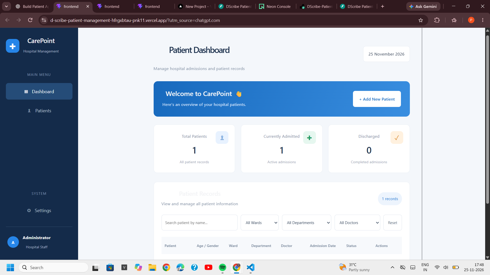
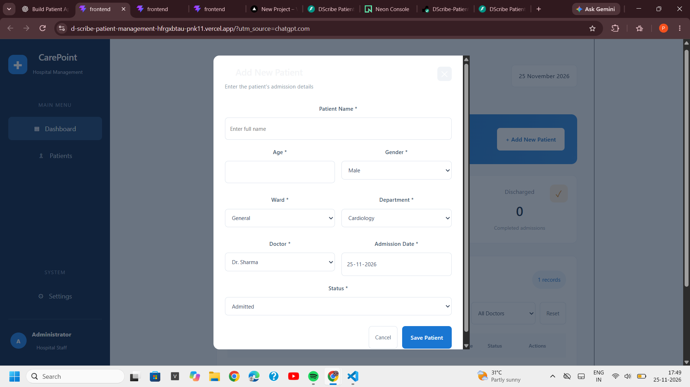
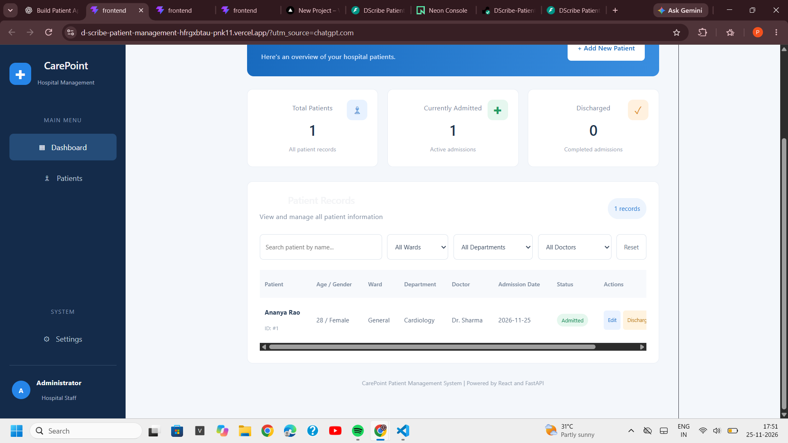

# DScribe Patient Admission Management System

A full-stack web application for managing hospital patient admission records. The application allows users to add, view, search, filter, update, discharge, and delete patient records through a responsive dashboard.

## Live Application

- **Frontend:** https://d-scribe-patient-management-hfrgxbtau-pnk11.vercel.app
- **Backend API:** https://dscribe-patient-management.onrender.com
- **API Documentation:** https://dscribe-patient-management.onrender.com/docs
- **GitHub Repository:** https://github.com/pranamya06/DScribe-Patient-Management

## Features

- Add new patient admission records.
- View all registered patients.
- Search patients by name.
- Filter patients by ward, department, and doctor.
- Edit existing patient details.
- Delete patient records with confirmation.
- Mark patients as discharged.
- Validate patient information on both frontend and backend.
- Responsive dashboard for different screen sizes.
- Persistent patient data using PostgreSQL.

## Technology Stack

**Frontend**
- React.js
- Vite
- JavaScript
- CSS

**Backend**
- Python
- FastAPI
- Pydantic
- Uvicorn
- Psycopg

**Database**
- PostgreSQL (Neon)

**Deployment**
- Vercel (Frontend)
- Render (Backend)
- Neon (Database)

## Patient Information

The application manages the following information:

- Patient Name
- Age
- Gender
- Ward
- Department
- Doctor
- Admission Date
- Admission Status (Admitted / Discharged)

## Project Structure

text
DScribe-Patient-Management/
├── backend/
│   ├── main.py
│   └── requirements.txt
├── frontend/
│   ├── src/
│   ├── public/
│   ├── package.json
│   └── index.html
├── screenshots/
├── .gitignore
└── README.md

## Local Setup Instructions

### Prerequisites

- Python 3.11 or later
- Node.js and npm
- Git
- PostgreSQL database connection string

### 1. Clone the repository

```bash
git clone https://github.com/pranamya06/DScribe-Patient-Management.git
cd DScribe-Patient-Management
```

### 2. Set up the backend

```bash
cd backend
py -m venv .venv
```

Activate the virtual environment in Windows PowerShell:

```powershell
.\.venv\Scripts\Activate.ps1
```

Install dependencies:

```bash
pip install -r requirements.txt
```

Set the database connection string in PowerShell:

```powershell
$env:DATABASE_URL="YOUR_POSTGRESQL_CONNECTION_STRING"
```

Start the backend:

```bash
uvicorn main:app --reload
```

Backend documentation:

http://127.0.0.1:8000/docs

### 3. Set up the frontend

Open another terminal:

```bash
cd frontend
npm install
```

Create a `.env` file inside the `frontend` folder with:

```text
VITE_API_URL=http://127.0.0.1:8000
```

Start the frontend:

```bash
npm run dev
```

Open:

http://localhost:5173

## Validation

The application validates patient details, including:

- Patient name is required and accepts letters and spaces only.
- Age must be between 0 and 120.
- Required dropdown fields must be selected.
- Admission date is required and cannot be in the future.
- Backend validation rejects invalid patient data.

## Deployment

- Frontend hosted on Vercel.
- Backend hosted on Render.
- PostgreSQL database hosted on Neon.

The deployed frontend communicates with the backend API using the `VITE_API_URL` environment variable. The backend uses `DATABASE_URL` to connect to PostgreSQL.

## Screenshots

## Screenshots

### Dashboard


### Add Patient


### Patient Management


## Developer
**Pranamya N K**

DScribe Software Engineer Intern – Round 1 Assignment